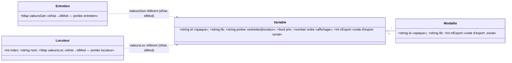
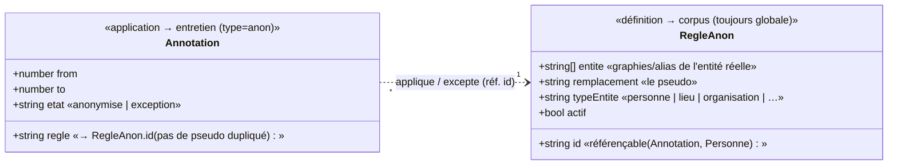

# Modèle objet — SonalAsynchro

> Ce document **est** le modèle objet de SonalAsynchro. Il porte les deux plans :
>
> - **Partie I — le domaine** : agrégats, entités, invariants, langage métier. Stable,
>   indépendant du stockage.
> - **Partie II — la technique** : le régime retenu — **fichiers locaux + verrous,
>   ProseMirror sans CRDT, un dossier = un corpus**. Choisi, remplaçable (voir §14).
>
> Il se lit seul, sans quitter ce dépôt.

**Principes directeurs** : le modèle est la vérité, le DOM n'en est qu'une projection, les
fichiers sont l'I/O. Toute édition du texte est une transaction ProseMirror ; les inventaires
sont des **requêtes**, jamais des caches persistés ; le cœur du modèle (`src/shared/`) est
**pur** — aucune I/O, aucun DOM, aucun accès electron (un test le vérifie mécaniquement).

---

# Partie I — le domaine

## Règles de lecture

**Règle n°1 — un agrégat n'est PAS un fichier.**

```
Corpus (agrégat conceptuel) = corpus.json (définitions + membership)
                            + N × entretiens/<id>.json   (RÉFÉRENCÉS, pas contenus)
                            + requêtes (inventaires : jamais stockées)

Entretien (agrégat conceptuel) = entretiens/<id>.json (contenu + applications)
                               + références → corpus.json (pour les définitions)
```

Conséquence : la granularité de **fichier** (un fichier = une unité de chargement et de
verrouillage) suit le coût de chargement, pas le découpage conceptuel. On charge un entretien,
pas le corpus entier.

**Règle n°2 — trois natures de donnée** (le fil rouge de tout le document) :

| Nature | Exemple | Plan technique | Stockée ? |
|---|---|---|---|
| **Définition** (existe avant tout usage) | `Categorie`, `RegleAnon`, `Variable`/`Modalite` | `corpus.json` | oui (primaire) |
| **Application** (décision portée par un entretien) | codage, masquage, valeur EAV, commentaire | `entretiens/<id>.json` | oui (primaire) |
| **Requête** (agrégation dérivable) | `Extrait`, matrice EAV, « à anonymiser », compteurs | — | non — **calculée** |

> **Nuance sur la règle n°2.** La règle interdit la **persistance** et l'**autorité**, pas la
> mémoïsation : un agrégat peut être mis en cache **volatil** (en mémoire, invalidé par compteur
> de version), tant qu'il n'est jamais écrit dans un fichier ni consulté comme vérité. (Seule
> entorse assumée : le PNG de forme d'onde audio, persisté parce que le décodage complet est
> coûteux — dérivé, régénérable, jamais lu comme vérité.)

**Règle n°3 — invariants de robustesse (comment le modèle se dégrade).**

Un modèle ne doit pas seulement être propre à l'état nominal : il doit dire comment il se
**dégrade** (fichier en retard, import d'un corpus plus ancien, références cassées).

| Invariant | Règle | Pathologie SonalPi interdite |
|---|---|---|
| **Référence pendante = inerte, conservée, signalée** | une référence qui ne résout plus (définition supprimée, ancre sur contenu disparu) rend la donnée porteuse **inerte** : exclue des requêtes, jamais supprimée en cascade, jamais réparée d'office ; elle apparaît dans une requête « références pendantes » | la **résurrection** : une variable supprimée du corpus revenait via l'inventaire d'un `.sonal` en retard |
| **Identité opaque, allocation sans collision** | une identité est une chaîne opaque : **déterministe à l'import** (reprise du code legacy), aléatoire à la création ; les codes séquentiels (`cat_XXX`, `v`, `m`) sont des **attributs d'export**, jamais des identités calculées (`max+1`) | deux allocations `max+1` → même code, deux sens ; l'un écrasé en silence |
| **Aucun flux montant hors sas d'import** | charger/lire une application n'écrit **jamais** une définition ; le seul canal applications→définitions est le **sas d'import explicite** (§13) | le chargement d'un entretien réinjectait dans le corpus toute définition trouvée dedans |
| **Réparation silencieuse interdite** | une incohérence détectée est **signalée** (requête qualité, notification) ; réparer est un geste utilisateur explicite | les reconstructions automatiques de l'agrégat masquaient les bugs au lieu de les révéler |

> Le cas des **ancres** est le même invariant : une plage dont le contenu a disparu devient une
> **annotation orpheline** — conservée, listée par requête, jamais purgée.

> **Corollaire — l'ordre d'affichage est une définition.** L'ordre des variables et l'ordre + la
> hiérarchie du codebook ne sont dérivables de rien : ils vivent explicitement sur l'entité —
> champ `ordre` et champ `parent` pour la hiérarchie du codebook. (Dans SonalPi, l'ordre était
> un artefact de la position dans `tabVar`/`tabThm` — une vérité logée dans la forme du
> stockage.)

## 1. Les agrégats

Deux frontières de cohérence (DDD), **étiquetées par la nature de leur contenu** :

```mermaid
classDiagram
    direction LR

    class Corpus {
        <<agrégat — définitions + membership>>
        +Categorie[] codebook        «définition»
        +RegleAnon[] reglesAnon       «définition (instruction)»
        +Variable[] variables         «définition (schéma EAV) — possède ses Modalite»
        +Personne[] personnes         «identité stable d'un locuteur à travers le corpus (optionnel)»
        +EntretienRef[] membership    «liste + métadonnées légères»
    }

    class EntretienRef {
        +string id
        +string titre
        +date date
        +string statut
        «PAS le contenu — juste de quoi lister/ouvrir»
    }

    class Entretien {
        <<agrégat — applications, 1 fichier dédié>>
        +Document corpsTexte          «doc ProseMirror (JSON)»
        +Annotation[] annotations     «codage | anon | commentaire»
        +Ancre[] ancres               «points de mesure temporels {pos, t}»
        +Map valeursGen               «idVar→idMod — variables de portée entretien»
        +Locuteur[] locuteurs         «possèdent leurs valeursLoc»
        +audioRef
    }

    class Bloc {
        +int loc        «-> Locuteur (attribut de paragraphe)»
    }

    class Annotation {
        <<concept unificateur — étage 2>>
        +string id
        +string type    «codage | anon | commentaire»
        +number from    «position ProseMirror, remappée aux éditions»
        +number to      «position ProseMirror, remappée aux éditions»
        +string auteur
        +string code    «codage → ref Categorie.id»
        +string regle   «anon → ref RegleAnon.id (pseudo lu depuis la règle)»
        +string etat    «anon → anonymise | exception»
        +string texte   «commentaire → contenu autonome»
    }

    class Extrait {
        <<dérivé — requête, non stocké>>
        +Categorie categorie
        +Annotation[] codagesContigus
    }

    Corpus "1" o-- "*" EntretienRef : membership
    Corpus "1" o-- "*" Categorie : codebook (définition)
    Corpus "1" o-- "*" RegleAnon : règles globales (définition)
    Corpus "1" o-- "*" Variable : schéma EAV (définition)
    Variable "1" o-- "*" Modalite : valeurs possibles (entité dépendante)
    Corpus "1" o-- "*" Personne : registre (optionnel)
    EntretienRef "1" ..> "1" Entretien : référence (fichier distinct)
    Entretien "1" *-- "1" Document : doc ProseMirror
    Entretien "1" *-- "*" Ancre
    Entretien "1" o-- "*" Annotation
    Entretien "1" o-- "*" Locuteur : possèdent leurs valeursLoc
    Locuteur "*" ..> "0..1" Personne : est (par id, optionnel)
    Bloc "*" --> "1" Locuteur : loc
    Annotation "*" ..> "0..1" Categorie : code (codage, par id)
    Annotation "*" ..> "0..1" RegleAnon : règle (anon, par id)
    Extrait "1" o-- "1..*" Annotation : regroupe codages contigus
    Extrait "*" --> "1" Categorie : relu (requête)
```

> **Par rapport à SonalPi.** (a) Le `Corpus` ne *contient* pas les entretiens : il en garde des
> **références légères** (`EntretienRef`) ; le contenu vit dans des fichiers séparés. (b) Les
> trois overlays inline de SonalPi (codage / anonymisation / commentaire, portés par des
> fragments HTML) **fusionnent** en un seul concept : **`Annotation`** (§2). (c) Les tables
> dupliquées local↔corpus (`tabDat`, `tabAnon`) **disparaissent** : une seule vérité par donnée
> + des requêtes (§5, §6).

> **Domicile des métadonnées de listing (`EntretienRef`).** `titre` / `date` / `statut`-workflow
> vivent dans le **membership de `corpus.json`** — **domicile unique**. Raison : la lecture
> chaude est *lister le corpus* (à chaque ouverture) ; elle doit être bon marché (lire le seul
> fichier corpus) **sans parcourir les N entretiens**. L'entretien **ne les reduplique pas**. Un
> `statut` *dérivable* (« codé » = l'entretien a des annotations) est une **requête**, pas un
> champ stocké. À l'export `.sonal`, ces champs sont **réinjectés** (recomposition, pas une 2ᵉ
> vérité).

## 2. Le concept unificateur : `Annotation` (étage 2)

Dans SonalPi, coder / anonymiser / commenter **découpe** le texte en fragments (spans HTML
portant des classes `cat_xxx`, `anon`, `obs`). Ici, **le texte n'est pas découpé par le
marquage** : c'est un calque autonome.

> Une `Annotation` = une entité indépendante qui **pointe** une plage de texte par deux
> positions ProseMirror (`from`/`to`, remappées à chaque édition — elles *suivent* le texte),
> et porte un `type`. Le marquage n'altère pas le texte ; il se **superpose** (rendu en
> *décorations*, pas en *marks*).

| `type` | Étage 1 (dictionnaire) | Champs propres | Autonome ? |
|---|---|---|---|
| `codage` | `Categorie` (par `code`) | `code` = id de catégorie | non (projette une définition) |
| `anon` | `RegleAnon` (par `regle`=id) | `regle`, `etat` (`anonymise`\|`exception`) | non |
| `commentaire` | **aucun** | `texte` (contenu) | **oui** (porte son sens) |

> **Pourquoi unifier.** Les trois calques (a) **regroupent une plage** avec un état mutualisé,
> (b) **se composent** (un passage codé *et* anonymisé *et* commenté), (c) sont au fond des
> plages de texte que le rendu épouse. Une seule structure — un tableau d'annotations
> indépendantes — couvre les trois. Le `commentaire` reste le seul **sans étage 1** : il porte
> son propre `texte`.

## 3. Le patron à 3 étages (conservé, relocalisé)

Codage et anonymisation suivent le même empilement ; seul l'**endroit** change par rapport à
SonalPi.

| Étage | Rôle | Codage | Anonymisation | Commentaire | Où |
|---|---|---|---|---|---|
| **1. Dictionnaire** | la *définition* | `Categorie` | `RegleAnon` (entité→pseudo) | — | **`corpus.json`** |
| **2. Marquage** | l'*`Annotation`* ancrée | `code`→`Categorie` | `etat`+`regle`→`RegleAnon` | `texte` | **`entretiens/<id>.json`** |
| **3. Lecture** | la *vue dérivée* | `Extrait` | compteurs + « à anonymiser » | (liste) | **requête (rien)** |

> Lecture verticale : on *définit* → ça se *matérialise* → on *relit* agrégé. La nuance
> historique tient toujours : une *catégorie* peut se poser n'importe où ; une *règle d'anon*
> conduit à des applications là où l'entité apparaît.

## 4. Colonne vertébrale du texte : le bloc (et la chute du `Fragment`)

- **Token** *(atome — sans objet propre)* : la plus petite unité (un mot, une ponctuation, une
  espace). Reste la **granularité du snap-to-mot** (une sélection est étendue aux frontières de
  mot). **Aucun rang de token stocké** : une position est une position ProseMirror ; la grille
  de tokens n'est pas un cache à renormaliser, elle se redérive à la sélection.
- **Bloc** *(structure authored par l'utilisateur)* : le texte vit dans des **paragraphes** du
  document ProseMirror, **édités librement** (WYSIWYG) — on n'importe **pas** la rigidité
  « une ligne par *cue* SRT ». Ce qui subsiste du « segment » : le **locuteur** (`loc`,
  attribut de bloc éditable ; tour de parole = dérivé) et le **timing**, porté non par le bloc
  mais par les **ancres temporelles** `{pos, t}` du modèle (partie II, §8). L'édition se borne
  au bloc ; la lecture l'enjambe (`Extrait`, invariant conservé).

> **Les niveaux imbriqués de SonalPi s'effondrent en WYSIWYG.** Le segment vient de la
> **retranscription assistée (SRT / sortie IA)** : une **unité horodatée** (`deb`/`fin`), fine.
> Les niveaux de SonalPi — `ligloc` (bloc locuteur), `lblseg sautlig` (une ligne par *cue*),
> fragments — étaient des **artefacts du pipeline de transcription + d'un rendu non-éditable**,
> pas des nécessités du domaine. En WYSIWYG, ils s'effondrent :
> - **fragments** → démis (décorations) ;
> - **tour de parole** (`ligloc`) → **dérivé** (run de blocs consécutifs de même `loc`), non
>   stocké. À l'**import**, les cues consécutifs d'un même locuteur non nul fusionnent en un
>   paragraphe (le tour), leurs frontières survivant en ancres internes ; aucun geste
>   d'**édition** ne fusionne ;
> - **`lblseg sautlig`** (une ligne par cue) → **pas une contrainte** : la structure de
>   paragraphes est authored par l'utilisateur ; la segmentation SRT n'est que la mise en page
>   initiale d'import.
>
> **Conséquence — `statut` disparaît, sans concept de remplacement.** Diviser un long monologue
> = un **saut de paragraphe** (Entrée), même `loc` ⇒ même tour ; une division **sémantique** =
> une **annotation** (codage/commentaire). Le `statut «deb|fin de tour»` de SonalPi — marqueur
> stocké d'une frontière dérivable — est **retiré** ; SonalPi le recalcule à l'ouverture d'un
> export.

- **`Fragment` → démis.** Chez SonalPi, le fragment était une plage de tokens **taillée par le
  marquage** (un changement de codage/anon/commentaire coupait le span). Ici, **le marquage ne
  coupe plus le texte** (calque de décorations) : le fragment n'a plus d'existence stockée. Il
  survit au mieux comme notion **dérivée de rendu** (une suite de texte couverte par un même jeu
  de décorations) — jamais persistée.
- **`Locuteur`** *(promu en entité)* : indexé **par entretien**. Il **possède ses valeurs EAV de
  portée locuteur** (`valeursLoc: idVar→idMod`, cf. §5) et peut **référencer (`0..1`) une
  `Personne` du corpus** (identité stable, cf. note). Le `loc` est au **niveau du bloc**, pas de
  l'annotation : donner un locuteur à une sous-partie = **scinder le bloc** (asymétrie SonalPi
  conservée — aucune fusion physique inverse : deux blocs adjacents de même `loc` restent deux
  paragraphes, rendus groupés).

> **`Personne` (corpus) — identité stable d'un locuteur à travers le corpus.** Un même humain
> (l'**interviewer**, souvent le même chercheur sur N entretiens ; un **interviewé** récurrent
> en longitudinal) peut apparaître comme `Locuteur` dans plusieurs entretiens. `Personne` est
> une entité **au niveau corpus** ; le `Locuteur` (par entretien) la **référence** (`0..1`,
> **optionnel** — un locuteur non identifié reste valide). **Répartition des attributs** (règle
> « daté = entretien ») : âge à la date, `valeursLoc`, rôle dans *cet* entretien → restent sur
> le **`Locuteur`** ; `Personne` ne porte que l'**identité**. Les « attributs stables d'une
> personne » se lisent par **requête** sur ses apparitions (conflits éventuels = signal
> qualité), plutôt que stockés deux fois.
>
> **Découplée de l'anonymisation.** `Personne` ne référence **pas** `RegleAnon`. Le cas « deux
> graphies → un pseudo » est couvert par les **alias slash** de `RegleAnon.entite`
> (`["Jean Martin", "Jean-Martin"] → X`), système généraliste valable pour personnes *comme*
> lieux/organisations. `Personne` est une pure **identité de locuteur**, justifiée par
> l'identité **trans-entretien** (longitudinal) et l'**interopérabilité** (annexe A).
>
> **À assumer** : (a) le rattachement locuteur→personne est **curatorial** (trivial pour
> l'interviewer, délibéré pour les interviewés) ; (b) `Personne` est une **couche optionnelle**
> (le modèle tourne sans — et l'UI actuelle ne l'expose pas) ; (c) **RGPD** — `Personne` est
> une **liaison ré-identifiante** entre entretiens : donnée sensible.

> **Invariant — un codage peut enjamber plusieurs blocs/locuteurs.** Les positions `from`/`to`
> vivent dans l'espace de positions linéaire du document ProseMirror, qui traverse les nœuds :
> une `Annotation` peut couvrir un passage à cheval sur plusieurs tours de parole, **en une
> seule entité** (rendu par une décoration qui surligne le texte des deux côtés de la
> frontière). C'est plus simple que SonalPi, qui devait coder « en deux temps » (un fragment par
> segment) puis **re-fusionner à la lecture**.
>
> **Conséquence assumée — l'attribution au locuteur devient une requête.** Un codage transverse
> n'« appartient » pas à un locuteur : « ce codage relève de quel(s) locuteur(s) ? » =
> **plage ∩ blocs.loc**, calculé (jamais stocké). Important pour les stats par locuteur
> (variables EAV de portée `loc`, `valeursLoc`).
>
> **Sémantique retenue** : *(a)* **une seule** `Annotation` qui enjambe l'échange (on code un
> passage de discours sur un thème, indépendamment de qui parle). Le découpage *(b)* en deux
> annotations (le thème par contribution) reste représentable si un cas l'exige, mais **(a) est
> le défaut**. *(Note d'implémentation : le snap-to-mot snappe chaque borne dans son propre
> bloc pour le cas multi-blocs.)*

## 5. Base de données (EAV) — une seule tenue



- **Schéma** (`Variable` + ses `Modalite`, `portee`) = **définition** → `corpus.json`. Non
  dérivable des valeurs (une modalité absente des données reste valide).
- **Valeur** = **application** → `entretiens/<id>.json`, **rattachée à son propriétaire** selon
  la `portee` : `entretien` → map `valeursGen` de l'**Entretien** ; `locuteur` → map
  `valeursLoc` du **Locuteur**. La `Donnee {e,v,l,m}` plate de SonalPi **se dissout** (le
  fichier = `e`, le propriétaire = l'owner, reste `idVar→idMod`) et le sentinelle **`l="all"`
  disparaît du modèle** (il est **réintroduit à l'export `.sonal` seulement** — artefact de
  format, jamais du modèle).
- **Matrice corpus** (le `tabDat` global de SonalPi) = **requête** (lit les deux domiciles),
  **jamais** un cache persisté — y compris quand elle est rendue **éditable** (éditer une
  cellule = une écriture ciblée chez le propriétaire, puis re-requête).

> **`Variable` est une entité ; `Modalite` est une entité *dépendante* (pas un pair).**
> `Variable` a une identité **autonome** (`id`) — on la crée/renomme/supprime. `Modalite` a une
> identité **relative** : elle ne veut rien dire hors de sa variable, et supprimer la variable
> supprime ses modalités. Ce n'est pas pour autant un *value object* : une **valeur EAV** la
> référence (par son `id`), donc elle a besoin d'une identité stable. → **Modalité est possédée
> par Variable** : ses modalités sont **imbriquées dans la variable** (tableau interne du JSON),
> pas une table corpus plate. Les codes numériques `v`/`m` de SonalPi survivent en **attributs
> d'export** `.sonal` (règle n°3 : jamais des identités allouées par `max+1`).

> **La « double tenue local↔corpus » de SonalPi disparaît.** Plus de `tabDat` corpus à
> reconstruire/aligner : la valeur a **un seul propriétaire** (l'entretien), l'inventaire est
> une lecture.

> **Portée entretien vs locuteur — la valeur va chez son propriétaire.** Une `Variable` a une
> `portee` (`entretien` ou `locuteur`, = le `champ` gen/loc de SonalPi). On ne **sous-type
> pas** la variable (tout est commun sauf la portée) ; on rattache la **valeur** à sa cible :
> l'**Entretien** (gen) ou le **Locuteur** (loc, promu en entité, §4). *(Contrepartie assumée :
> la matrice corpus lit **deux domiciles** au lieu d'une table plate — ça reste une requête,
> pas un cache.)*

## 6. Anonymisation — 3 états, dont **un seul** dérivé



| État | Nature | Traitement |
|---|---|---|
| Règle `entite→remplacement` | **définition** | `corpus.json` (`RegleAnon`) — **toujours globale** |
| **Anonymisé** | **application** positive | `Annotation(anon, etat=anonymise, regle→)` ; pseudo **lu depuis la règle** |
| **Exception** (matche mais à ne pas masquer) | **application** négative — *doit* être stockée | `Annotation(anon, etat=exception, regle→)` |
| **À anonymiser** | **requête** = `règles ∩ texte − (anonymisé ∪ exception)` | décoration éphémère, **jamais persistée** |

> **Attributs de `RegleAnon`.** `id` (référençable) ; `entite` = les **graphies/alias** de
> l'entité réelle (« Pierre Lemaitre », « P. Lemaitre ») ; `remplacement` = **le pseudo** ;
> `typeEntite` (`personne | lieu | organisation | …`) ; `actif`. **Restent dehors**
> (caches/requêtes, jamais stockés) : `occurrences`, `matchPositions`,
> `presentMaisNonAnonymise`.
>
> **Toutes les règles sont globales (corpus) — pas de règle locale.** Une règle vit **toujours**
> dans `corpus.json` — c'est *le but* du dictionnaire partagé : un pseudo **constant** partout.
> La « détection locale » n'est pas une règle stockée mais la **requête « à anonymiser »** (qui
> *propose* d'ajouter au dictionnaire). **Limite connue (différée)** : une même graphie pour
> **deux personnes différentes** ne se distingue pas par une règle globale unique → ce sera le
> rôle de `Personne` (anonymisation **par personne**, pas par chaîne), le jour où le besoin se
> présente.
>
> **Symétrie avec le codage — le pseudo vit sur la règle, pas sur l'annotation.** Un
> `Annotation(codage)` stocke l'**id de la `Categorie`** (pas le libellé) ; de même un
> `Annotation(anon)` stocke l'**id de la `RegleAnon`** (`regle`) + son `etat` — **pas** le
> pseudo, lu depuis la règle. Renommer un pseudo = éditer la règle, répercuté partout, **zéro
> double-tenue**.
>
> **Sémantique : « proposer globalement, décider localement ».** La règle vit au corpus ; à
> l'ouverture, les occurrences non décidées apparaissent en *à anonymiser* (requête), validables
> (*anonymisé*) ou rejetables (*exception*).
>
> **État actuel** : le modèle est complet et les annotations/règles d'anon d'un `.sonal`
> importé sont **portées et réexportées sans perte** (elles suivent le remapping comme les
> codages), mais l'**UI d'anonymisation n'existe pas encore** (voir `docs/plan_anon.md`).

## 7. Recueil & lecture (collecte d'extraits)

C'est le versant **lecture** où l'`Extrait` (requête, §3) devient un objet manipulé (on le
*collecte*). Un `Recueil` = une liste d'`ItemRecueil {rang, type, rgdep, rgfin, texte,
commentaire}`. ⚠️ Le `commentaire` d'un item de recueil annote un *extrait collecté* — **rien à
voir** avec l'`Annotation(commentaire)` posée sur le texte (homonyme conservé).

**État actuel** : pas d'écran de recueil ; la **requête Extraits** (1 annotation = 1 extrait,
locuteurs attribués par `plage ∩ blocs.loc`) existe dans le code
(`src/shared/entretien/`, `src/renderer/`) et resservira pour un futur écran de recueil.

---

# Partie II — la technique (régime fichiers)

## 8. Le conteneur d'état

- **Vérité de session** : l'agrégat en mémoire (objets TS purs — `Entretien`, `Corpus`). Les
  **commandes de domaine** (`src/shared/`) sont les seules écritures ; elles ne connaissent ni
  le DOM ni le disque (critère vérifié mécaniquement par un test).
- **Positions** : le plugin de remapping (`src/renderer/editor/remap.ts`) est le **seul
  écrivain** des positions du modèle, à chaque transaction ProseMirror. Deux familles de
  positions suivent les éditions par ce canal :
  - les `from`/`to` des **annotations** (bornes non extensibles, `assoc` +1/-1 ; plage
    supprimée → **orpheline**, `estOrpheline` = requête, conservée, signalée — l'invariant
    *référence pendante* appliqué aux ancres) ;
  - les `pos` des **ancres temporelles** (`assoc` -1 ; ancres effondrées par une suppression →
    plage vide, enjambée à la lecture, jamais purgée).
- **Éditeur** : TipTap, schéma `doc › bloc{loc}` — **contrat gelé** : toute évolution du schéma
  = **migration explicite** des fichiers natifs (`formatVersion`, §11). Le rendu du marquage =
  décorations projetées depuis le modèle ; le surlignage de lecture audio = **une** décoration
  inline entre les deux ancres encadrant l'instant courant.
- **Temps** : `entretien.ancres` = liste triée de points de mesure `{pos, t}` (bornes de cue
  SRT aujourd'hui, une ancre par mot demain — même mécanisme, seule la densité change). Jamais
  de temps **fabriqué** : seules les bornes mesurées sont persistées ; tout le reste est
  **dérivé** en dichotomie — plage lue, interpolation au prorata du texte entre ancres (les
  trous laissés par les scissions sont répartis linéairement), seek au clic. À l'import, les
  cues consécutifs d'un même locuteur fusionnent en un paragraphe (le tour), leurs frontières
  survivant en ancres internes ; l'export re-découpe un segment par intervalle d'ancres
  (round-trip canonique). **Invariants de perf** (actés pour ~30 000 ancres en word-level) :
  les ancres sont des données triées **hors DOM** (jamais un nœud/décoration par ancre) ; une
  seule décoration inline à la fois ; lookups en **dichotomie** O(log n).

## 9. Format natif : le dossier de corpus

```
MonCorpus/                      ← un corpus = un dossier (copiable, sauvegardable)
  corpus.json                   ← définitions + membership (verrou : corpus.lock)
  entretiens/
    <id>.json                   ← un entretien = un fichier (verrou : <id>.lock)
  audio/                        ← médias copiés (audioRef relatif) + formes d'onde dérivées
  corbeille/                    ← entretiens « supprimés » (jamais effacés par l'app)
```

**`corpus.json`** :

```jsonc
{
  "formatVersion": 2,
  "codebook":   { "<id>": { "nom", "couleur", "taille?", "ordre", "parent": null, "actif", "codeExport": "cat_005" } },
  "variables":  { "<id>": { "lib", "portee": "entretien|locuteur", "priv", "ordre", "vExport": 3,
                            "modalites": [ { "id", "lib", "mExport": 2 } ] } },
  "reglesAnon": { "<id>": { "entite": ["…"], "remplacement", "typeEntite", "actif" } },   // sans UI
  "personnes":  { },                                                                      // sans UI
  "membership": { "<id>": { "titre", "date", "lastModified": "…" } }
}
```

**`entretiens/<id>.json`** :

```jsonc
{
  "formatVersion": 2,               // v1 (attrs deb/fin par bloc) → migré à la lecture (§11)
  "corpsTexte":  { /* doc ProseMirror JSON — blocs avec attr loc (un paragraphe = un tour à l'import) */ },
  "annotations": [ { "id", "type": "codage|anon|commentaire", "from", "to", "auteur",
                     "code|regle+etat|texte" } ],
  "ancres":      [ { "pos", "t" } ],  // temps MESURÉS, triés par pos — le reste est dérivé
  "locuteurs":   [ { "index", "nom", "interviewer?", "valeursLoc": { "<idVar>": "<idMod>" }, "personneRef": null } ],
  "meta":        { "valeursGen": { "<idVar>": "<idMod>" }, "audioRef": null }
}
```

- **Positions et texte sont sérialisés atomiquement** (même fichier, même instant) → valides par
  construction à la relecture, zéro reindexation.
- Les entretiens référencent les définitions **par id** — renommer/recolorer une définition
  n'écrit que `corpus.json`.
- **Aucun agrégat persisté** : matrice EAV, extraits, compteurs d'usage, « à anonymiser »,
  références pendantes = requêtes (mémoïsation **volatile** admise — règle n°2, nuance).

## 10. Identités (règle n°3, incarnation fichiers)

| Entité | Identité | Code legacy (attribut d'export) |
|---|---|---|
| `Categorie` | `id` opaque — **déterministe à l'import** (reprend `cat_XXX`), aléatoire à la création | `codeExport` (`cat_XXX`, renuméroté à l'export si absent) |
| `Variable` / `Modalite` | idem (import : `v`/`m` repris) | `vExport` / `mExport` |
| `Annotation` | id aléatoire (jamais de sens legacy) | — |
| `Entretien` | id opaque — import : repris du fichier ; création : aléatoire | — |
| `Locuteur` | **`index` numérique par entretien, conservé** (compat `data-loc`, référencé par l'attr de bloc) | lui-même |
| `Ancre` | **aucune** — une ancre est une VALEUR `{pos, t}` (point de mesure), pas un objet référencé ; deux ancres identiques sont interchangeables (dédupliquées à l'import) | `data-deb`/`data-fin` re-dérivés par segment à l'export |

> **Pourquoi `Ancre` n'a pas d'identité — et pourquoi ce n'est pas une entorse à la règle
> n°3.** La règle vise les entités qu'on *référence* (un codage pointe une catégorie par id).
> Rien ne référence jamais une ancre : c'est un point de mesure, remplaçable par tout point
> équivalent — un id serait du cruft. Le pendant : aucune « référence pendante » possible sur
> les ancres ; leur seule pathologie (effondrement par suppression de texte) est tolérée à la
> lecture, jamais réparée d'office.
>
> **Pourquoi `Locuteur.index` échappe (provisoirement) à la règle.** Sous verrou, un entretien
> a **un seul écrivain** : l'allocation `max+1` locale à l'entretien est sûre, et l'index est ce
> que le `.sonal` référence. **Si le stockage devenait multi-écrivain** (cible synchrone, §14),
> il devrait suivre le même traitement que les modalités (id opaque + index d'export) — dette
> consignée, pas un oubli.
>
> Le déterminisme des ids d'import rend le **sas idempotent** : ré-importer le même `.sonal`
> (ou l'importer sur deux postes puis fusionner les corpus à la main) converge au lieu de
> dupliquer.
>
> **Les codes d'export sont stables** : attribués une fois (repris à l'import, ou alloués au
> premier export et **réécrits dans `corpus.json`** à ce moment-là), jamais renumérotés ensuite
> — deux exports successifs produisent les mêmes `cat_XXX`/`v`/`m` (pas de churn de diff,
> réimport idempotent).

## 11. Version, fraîcheur, intégrité (le volet fichiers des invariants)

Ce qu'une base ou un CRDT donnerait par construction (une seule vérité synchronisée), le régime
fichiers doit le **surveiller** :

- **`formatVersion`** dans chaque fichier : version inconnue → **refus poli** (pas
  d'écrasement, pas de tentative de lecture partielle) ; montée de version = **migration
  explicite** à l'ouverture. *Première incarnation* : v1→v2 — les attrs `deb`/`fin` des blocs
  deviennent des `ancres {pos, t}` (fonction pure `src/shared/entretien/migration.ts`, appelée
  par le store à la lecture, fichier réécrit aussitôt, `lastModified` **préservé** : migrer
  n'est pas une édition).
- **Fraîcheur croisée** : `membership.lastModified` est mis à jour à chaque sauvegarde de
  l'entretien. À l'ouverture, un `entretiens/<id>.json` **plus ancien** que ce que le
  membership a connu (fichier restauré d'une sauvegarde, copie partielle du dossier) →
  **alerte**, jamais d'écrasement silencieux.
- **Écriture atomique** (write-tmp-rename) : un crash ne corrompt pas l'état précédent.
- **Filet anti-erreur — `.bak` à 2 générations, tourné par session.** Au **premier**
  enregistrement suivant l'ouverture d'un entretien, la version sur disque bascule en `.bak1`
  (l'ancien `.bak1` → `.bak2`). L'**autosave ne tourne pas** les générations (il ne fait que
  remplacer le fichier courant) : les `.bak` capturent l'état d'**avant les sessions
  précédentes**, pas les dernières secondes — c'est ce qui rend le filet utile contre une
  erreur aperçue après coup. Restauration manuelle (JSON lisible), pas d'UI.
- **Références pendantes en régime fichiers** : même avec les politiques de refus de
  suppression (un thème ou une modalité encore utilisés ne peuvent pas être supprimés —
  *prévention*), un fichier en retard peut porter des références vers des définitions
  disparues. La règle n°3 est la *tolérance* : valeurs/annotations pendantes **inertes**
  (filtrées des requêtes), **conservées**, listées par la requête « références pendantes » —
  jamais purgées ni réparées d'office.

## 12. Inventaires = requêtes

`Extrait`, matrice EAV, « à anonymiser », « où est utilisé `cat_005` », résumés thématiques des
cartes corpus : **aucun** n'est stocké.

- **Intra-entretien** (extraits d'un entretien ouvert) : requête locale sur le modèle chargé.
- **Transverse** (sur tout le corpus) : **lecture du dossier** — tous les fichiers sont locaux,
  le store (process main) les scanne et projette le résultat au renderer. Pas d'index, pas de
  cache qui dérive ; si un jour le volume l'exige, l'indexation irait dans le **store**,
  invisible aux composants.

Conséquence architecturale (scopes de l'UI) : le renderer ne tient **jamais** tous les
entretiens — working set = définitions corpus (petit) + membership (métadonnées) + **un**
entretien ouvert + résultats de requêtes transitoires.

## 13. Import / export : le sas `.sonal`

**Tout format étranger passe par `.sonal`.** Un seul point d'entrée dans le modèle :

```
fichier étranger (.srt/.vtt/.txt) → convertisseurs SonalPi (vendorés, purs)
  → chaîne HTML .sonal → importateur → modèle
```

Zéro parseur neuf : fidélité de comportement garantie (mêmes cues, même détection de locuteurs
que SonalPi, `<v Nom>` VTT compris).

- **Import** : `cat/var/dic-json` → **fusion dans `corpus.json`** (par id **déterministe** —
  règle n°3 — donc **idempotente** : un code déjà présent fait foi, pas de doublon) ; contenu +
  `dat-json` + masquages + locuteurs → `entretiens/<id>.json`. Les timecodes des cues
  deviennent des **ancres** (2 par cue) ; les cues consécutifs d'un même locuteur non nul
  **fusionnent en un tour** (frontières conservées en ancres internes) ; `data-loc="0"`
  (= « aucun locuteur ») est normalisé en `null`.
- **Export** : recomposer un `.sonal` auto-suffisant (codebook tiré du corpus + contenu de
  l'entretien), **rouvrable dans SonalPi** — c'est le juge de paix du projet (cf.
  `PARITE.md`). Un segment par **intervalle d'ancres** : le tour ressort re-découpé en cues
  avec leurs `data-deb`/`data-fin` ; le sentinelle EAV `l="all"` et le « ? » d'interviewer sont
  **réintroduits à l'export seulement** (artefacts de format, jamais du modèle) ; la
  hiérarchie du codebook ressort en `rang` = profondeur (reconstruite en `parent` à l'import).
- **Invariant (sens unique, règle n°3)** : ce sas est le **seul** flux
  applications→définitions. *Ouvrir/charger* un entretien n'écrit jamais dans le
  codebook/schéma/dictionnaire.

## 14. Réversibilité vers une cible synchrone

Le conteneur d'état est **isolé** (le domaine ne connaît ni les fichiers ni ProseMirror) pour
qu'on puisse un jour remplacer le régime fichiers par un régime synchrone (CRDT/Yjs) **sans
toucher au domaine**. Cette bascule est explorée dans le dossier frère
[`../../SonalSynchroYjs`](../../SonalSynchroYjs). Ce qui changerait, et seulement ça :

| Concept (commun) | SonalAsynchro (fichiers) | Cible synchrone |
|---|---|---|
| Corps-texte (`Document`) | doc ProseMirror (JSON canonique) | `Y.XmlFragment` |
| `Annotation[]` | tableau d'objets TS | `Y.Array` de `Y.Map` |
| Ancre (survit aux éditions) | position PM absolue + remapping `tr.mapping` | `RelativePosition` — pour les deux familles (`from`/`to` des annotations ET ancres temporelles `{pos, t}`) |
| Agrégat Corpus | `corpus.json` | `corpus.ydoc` (room) |
| Agrégat Entretien | `entretiens/<id>.json` | `entretien.ydoc` (room) |
| Concurrence | **verrou par fichier** (un écrivain à la fois) | fusion CRDT |
| Requête transverse | lecture du dossier (tout est local) | index côté serveur |
| Persistance | écriture atomique (write-tmp-rename) par le main process | persistance serveur + réplica local |

---

# Annexe A — piste : export vers d'autres CAQDAS (REFI-QDA)

> **Statut : piste d'interopérabilité, non implémentée.** Consignée ici parce qu'elle
> **justifie** des choix du modèle — notamment garder `Personne` et l'idée de *variable
> indicatrice de cas*. À figer sur le **XSD réel** (codingformat.org) avant d'implémenter.

REFI-QDA (format **QDPX** = zip `Project.qde` XML + sources) est le **standard d'échange**
entre CAQDAS (ATLAS.ti, NVivo, MAXQDA, Quirkos, Dedoose…). Pouvoir l'exporter = un levier
d'adoption (sortir un corpus vers l'outil du labo).

| Notre modèle | REFI-QDA | Qualité |
|---|---|---|
| `Categorie` (codebook) | `Code` (guid, nom, couleur, hiérarchie) | direct |
| `Variable` / `Modalite` | `Variable` (typée) + valeurs | bon (modalités aplaties en texte) |
| `Entretien` (texte) | `TextSource` (plainText) | direct |
| `Annotation(codage)` | `PlainTextSelection` (start/end **char**) + `CodeRef` | direct (positions → offsets à l'export) |
| `Annotation(commentaire)` | `Note` liée à une sélection | bon |
| **`Personne`** | **`Case`** | clé — voir ci-dessous |

Le `Case` REFI-QDA est l'**unité d'analyse** (une personne, un site, une organisation…). Deux
sources de `Case` dans notre modèle : (1) **`Personne` → `Case`** (participant) — sans elle, il
faudrait synthétiser des Cases à partir des Locuteurs et perdre le regroupement « même personne
sur N entretiens » ; (2) **variable indicatrice de cas → `Case`** (non-personne) : marquer une
`Variable` (ex. `établissement`) dont les valeurs distinctes deviennent des cas — mécanisme
général qui couvre les cas non-personnes sans proliférer d'entités.

**Ce qui NE mappe pas** (export lossy, à sens quasi unique) : l'anonymisation comme calque
(appliquer les pseudos dans le texte, ou la perdre), `Locuteur` comme structure (pas de speaker
first-class), le timing fin (ancres → points de synchro média, non trivial).
