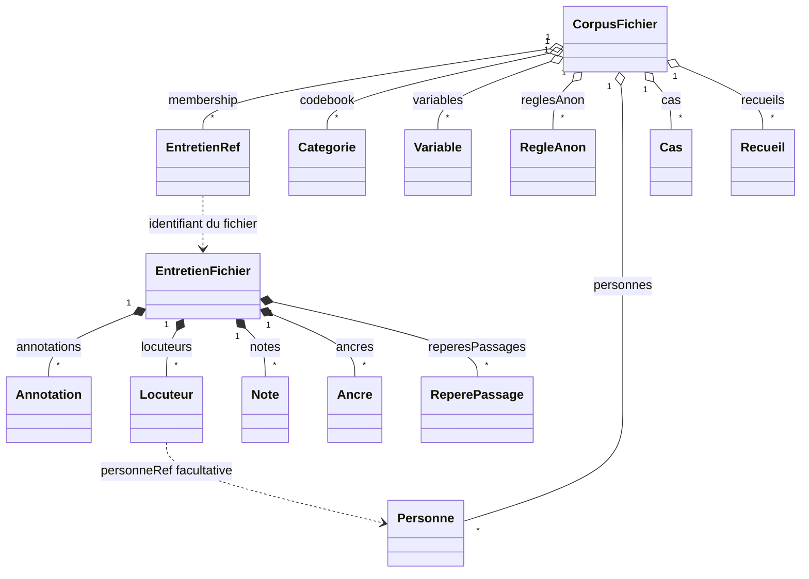

# Modèle objet — les relations essentielles

Le modèle natif distingue **les définitions du corpus** et **les données propres
à chaque entretien**. Les types de référence sont dans `src/shared/format.ts`,
complétés par les modules métier de `src/shared/`. Cette page est une carte de
leurs relations, pas une copie exhaustive des interfaces TypeScript.

## Corpus et entretiens

`corpus.json` contient les définitions communes et le `membership`, une liste de
références légères vers les entretiens. Il ne contient pas leurs transcriptions.
Chaque `entretiens/<id>.json` porte son texte et ses données propres.

Une référence `EntretienRef` permet de lister une source : titre, date et
métadonnées de classement. Le contenu doit être chargé séparément. Les fichiers
sont deux frontières de modification ; une opération qui les touche ensemble
nécessite une orchestration explicite, pas une simple mutation d’objet.

## Propriétaires des données

| Dans `corpus.json` | Dans le fichier d’entretien |
|---|---|
| Thèmes, hiérarchie et descriptions du codebook. | Codages de plages référant les thèmes. |
| Variables, modalités et portée. | Valeurs d’entretien ou de locuteur. |
| Règles textuelles de pseudonymisation et paramètres partagés. | Décisions textuelles, brouillons et définitions locales. |
| Personnes. | Locuteurs et liens vers les personnes. |
| Catégories de notes. | Notes et liens vers commentaires ou locuteurs. |
| Cas, familles et attributs ; recueils et items éditoriaux. | Repères des passages référencés par les cas et recueils. |
| Tableau de bord et réglages Lexico. | Aucun duplicata des résultats d’analyse. |

Le nom de projet, l’origine d’une migration et l’identité d’un corpus exemple
peuvent également vivre au corpus. Les récents, les comptes et les secrets du
poste ne sont pas des données métier à ajouter dans ce fichier.

## Texte, annotations et repères

Le texte est un document ProseMirror (`corpsTexte`). Une annotation est une plage
`[from, to[` de ce document, avec une identité et un type :

- `codage` référence une catégorie du codebook par `code` ;
- `anon` conserve la décision textuelle, le pseudonyme choisi et l’éventuel lien
  `regle` vers une définition corpus ;
- `commentaire` porte son propre texte et son auteur, sans définition corpus.

Une annotation peut traverser plusieurs paragraphes et locuteurs sans découper
physiquement la transcription. L’appartenance de ce passage aux tours de parole
est calculée à la lecture, pas enregistrée sur l’annotation.

Un `ReperePassage` est une autre plage identifiée, indépendante d’un codage.
Cas et recueils le référencent par `{ entretienId, repereId }`, sans copier ses
bornes ni son texte. Les annotations et repères suivent les corrections par
remappage ; une plage entièrement supprimée reste signalée comme orpheline.

Les `Ancre { pos, t }` relient une position du texte à un temps mesuré en secondes.
Une interpolation entre ancres est un calcul de lecture, pas un nouvel horodatage
à enregistrer. Voir [éditeur et positions](donnees.md#éditeur-et-positions-dans-le-texte).

## Thèmes et variables

Un thème est une `Categorie` du codebook. Son identité ne dépend ni de son nom,
ni de son rang. `parent` et `ordre` portent explicitement la hiérarchie ;
`codeExport` est un attribut du format historique, pas l’identité métier.
Voir [thématiques](traiter/thematiques/README.md).

Une `Variable` définit sa portée et ses modalités. La valeur va chez son
propriétaire : `meta.valeursGen` pour l’entretien, `Locuteur.valeursLoc` pour un
locuteur. Les identifiants de variable et de modalité relient valeur et définition.
La table de données est une lecture de ces propriétaires, pas une seconde table
persistée. Voir [variables](traiter/variables.md).

## Pseudonymisation

Une règle `RegleAnon` définit des alias et des pseudonymes partagés. Elle ne prouve
pas qu’une occurrence a été traitée. L’annotation conserve la décision réellement
prise sur le texte, notamment la variante de pseudonyme choisie ou l’exception.

Un brouillon n’est pas une règle corpus. Les définitions textuelles locales
complètent la mémoire d’un entretien sans créer d’occurrence implicite.
Les occurrences restant à traiter et leurs compteurs sont calculés à partir du
texte, des règles et des décisions existantes. Voir
[pseudonymisation](traiter/pseudonymisation/README.md).

## Locuteurs et personnes

Trois identifiants ont des usages distincts :

- `Locuteur.index`, local à l’entretien, est référencé par l’attribut `loc` des
  paragraphes ;
- `Locuteur.id`, stable, sert notamment aux liens de notes et aux rapprochements
  entre versions ; il peut manquer dans les anciens fichiers ;
- `Personne.id`, au corpus, rapproche des locuteurs par `personneRef`.

Un nom ou un index identique dans deux entretiens ne désigne pas une même personne.
La personne ne possède ni les valeurs ni les notes de ses locuteurs et ne
synchronise pas leurs pseudonymes. Renommer un locuteur ne réécrit pas les blocs
qui référencent son index ; attribuer une sous-partie de paragraphe peut en
revanche nécessiter de le scinder. Voir [locuteurs et personnes](traiter/locuteurs/README.md).

## Notes, cas et recueils

Une note est un document autonome, hors transcription, sans position ProseMirror.
Elle référence une catégorie commune et peut viser des locuteurs ou des
commentaires du même entretien. Son corps HTML est restreint et nettoyé par le
renderer ; ses libellés de commentaires sont reconstruits à l’affichage.
Voir [notes](traiter/notes/README.md).

Un cas sélectionne des matériaux par règles et ajouts manuels. Un recueil compose
explicitement un document ordonné avec des titres, textes libres et passages.
Tous deux résolvent leurs références depuis les entretiens courants. Leurs
projections ne remplacent jamais leurs définitions ; supprimer une référence ne
supprime pas la transcription. Voir [cas](organiser/cas.md) et
[recueils](organiser/recueils.md).

## États calculés, journaux et stockage

Résumés, suggestions, résultats de Synthèse, matrices et index Lexico sont dérivés.
Leurs critères ou recettes peuvent être persistés sans que leurs résultats le
soient. Voir [les natures de données](donnees.md#définitions-usages-et-résultats-calculés).

Les journaux d’actions sont volatils : leurs inverses typés permettent d’annuler
certaines commandes métier, pas de rejouer toute l’histoire du corpus. Ils sont
limités à dix entrées et ne proposent pas de rétablissement. Le journal d’entretien
est vidé à son ouverture ; celui du corpus lors d’une bascule ou d’un redémarrage.
La frappe utilise l’historique ProseMirror ; les inverses portant des positions
sont remappés et une cible disparue rend l’annulation indisponible.
Ces journaux ne doivent pas être confondus avec les journaux durables de
récupération des opérations de fichiers ou des publications distantes.

Le main possède la persistance. Les modèles purs restent dans `shared/`, les
adaptations ProseMirror dans `renderer/editor/`, et les entrées/sorties dans les
services du main. Voir [architecture](architecture.md),
[commandes et persistance](donnees.md#commandes-et-persistance) et
[format natif](donnees.md#format-natif-et-compatibilité).

## Points d’entrée dans le code

| Besoin | Emplacement |
|---|---|
| Contrats natifs et relations entre objets | `src/shared/format.ts` |
| Définitions et commandes corpus | `src/shared/corpus/` |
| Annotations, locuteurs, notes, ancres et repères | `src/shared/entretien/` |
| Positions et projections liées au document | `src/shared/entretien/positions.ts`, `src/renderer/editor/` |
| Journaux d’actions | `src/shared/entretien/journal.ts`, `src/shared/corpus/journal.ts`, `src/main/journalCorpus.ts` |
| Persistance locale | `src/main/corpusStore.ts` |
| Persistance distante et disponibilité des gestes | [distant/](distant/README.md) |

Les règles métier détaillées, les commandes et leurs tests sont documentés dans
les pages fonctionnelles liées ci-dessus. Avant de changer un type, y vérifier
ses usages, ses règles de suppression et ses limites selon le fournisseur.
