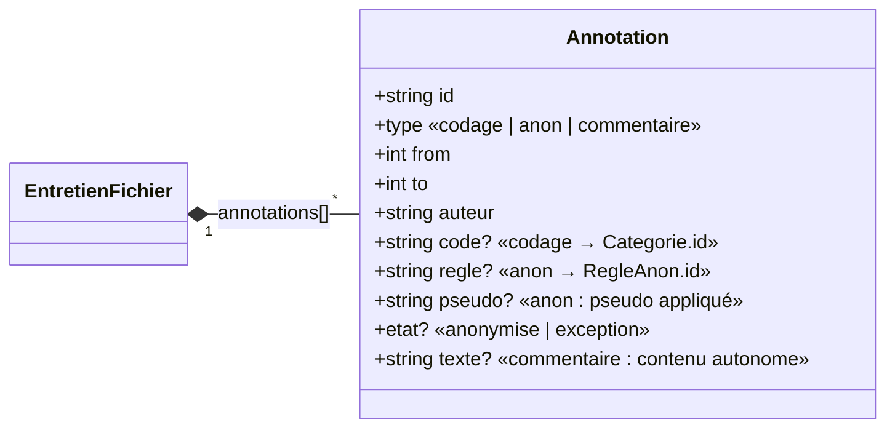
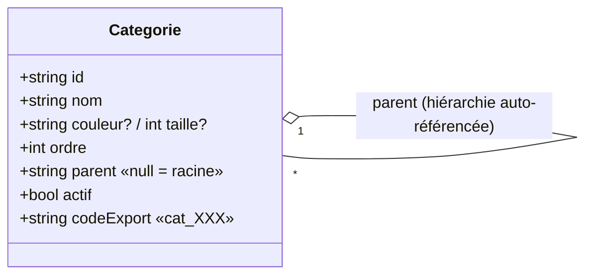
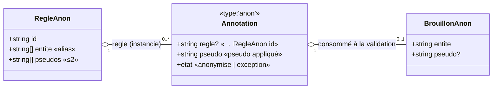
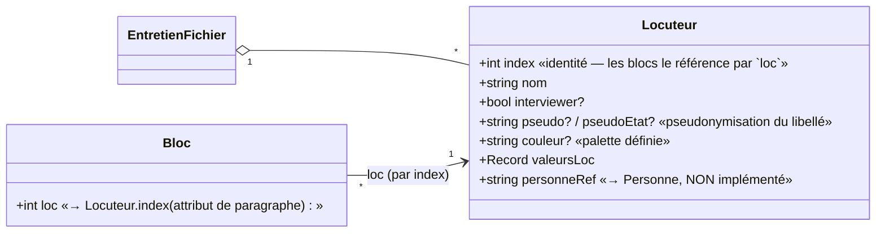
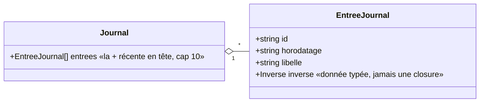

# Modèle objet — vue à 3 niveaux

> Ce document décrit le modèle d'objet de **SonalPiTestV2**, recalé sur le **code actuel**.
> Il reprend la structure « vue à 3 niveaux » des premières réflexions (POC `MODELE_OBJET.md`) :
> une **vue d'ensemble** stable, puis des **sous-schémas par préoccupation** (un diagramme et un
> ancrage code chacun), puis des **notes en prose**. Contrairement à SonalPi V1, le modèle est
> ici **explicite** : il est directement écrit en TypeScript dans `src/shared/`.

---

## Principe d'organisation (les 3 niveaux)

| Niveau | Contenu | Section |
|---|---|---|
| **1 — Vue d'ensemble** | les **agrégats**, le patron à 3 étages et la colonne vertébrale du texte | §1, §2 — court et stable |
| **2 — Sous-schémas par préoccupation** | un cluster cohérent, sa logique, son lien avec les fichiers | §3 à §9 — un diagramme chacun |
| **3 — Notes en prose** | asymétries, non-implementé, carte code ↔ modèle | §10, §11 |

> **Ce qui s'est effondré depuis SonalPi V1.** Le code actuel a **supprimé** une grande partie de
> la complexité que le doc initial devait documenter : la **double tenue** EAV local↔corpus
> (v2 : une seule vérité par donnée), la **triple tenue** d'anonymisation (règle ↔ occurrence ↔
> cache corpus), les **fragments** coupés par le marquage (v2 : plages de positions ProseMirror),
> et l'`Extrait` (v2 : une **requête**). Chaque sous-schéma ci-dessous le constate au passage.

---

# Niveau 1 — Vue d'ensemble

## 1. Les agrégats

> **Qu'est-ce qu'un « agrégat » ?** (terme *Domain-Driven Design*) : une **frontière de
> cohérence**, un cluster d'objets traité comme une seule unité. Ici chaque agrégat est **explicite**
> et reflète un fichier : `corpus.json` = **Corpus**, `entretiens/<id>.json` = **Entretien**.

Le domaine a **deux agrégats** — un concept ≠ un fichier physique :
- **Corpus** (concept) = `corpus.json` (définitions + membership) + N fichiers entretien + requêtes ;
- **Entretien** (concept) = `entretiens/<id>.json`, seul MAIS dépendant du corpus pour interpréter
  ses références (`cat_005`, `v3m1`…).

> **Fondamental : le Corpus ne *contient* pas les entretiens.** Il n'en garde que des **références
> légères** (`EntretienRef` : titre, date, lastModified — rien du contenu). Le contenu vit dans un
> fichier séparé par entretien.

```mermaid
classDiagram
    direction LR

    class CorpusFichier {
        <<corpus.json — agrégat Corpus>>
        +Record codebook «Categorie[]»
        +Record variables «Variable[]»
        +Record reglesAnon «RegleAnon[]»
        +Record personnes «REFLECHI, non implémenté»
        +Record membership «EntretienRef[]»
        +string nom?
        +meta? sourceV1, demo
    }

    class EntretienRef {
        +string titre
        +string date
        +string lastModified
        «PAS le contenu — de quoi lister/ouvrir»
    }

    class Categorie {
        +string id «opaque, déterministe à l'import»
        +string nom
        +string couleur?
        +int taille?
        +int ordre «explicite, jamais dérivé»
        +string parent «null = racine — hiérarchie»
        +bool actif
        +string codeExport «cat_XXX — export .sonal, pas l'identité»
    }

    class Variable {
        +string id «opaque, déterministe: v{n}»
        +string lib
        +portee «entretien | locuteur»
        +bool priv
        +int ordre
        +int vExport «code export .sonal»
        +Modalite[] modalites
    }

    class RegleAnon {
        +string id
        +string[] entite «alias séparés par entité»
        +string[] pseudos «1..2 pseudos»
    }

    class EntretienFichier {
        <<entretiens/<id>.json — agrégat Entretien>>
        +unknown corpsTexte «doc ProseMirror (JSON)»
        +Annotation[] annotations «codage | anon | commentaire»
        +Ancre[] ancres «{pos, t}»
        +Locuteur[] locuteurs
        +MetaEntretien meta «valeursGen, audioRef»
        +BrouillonAnon[] brouillonsAnon?
        +pseudosDeclares?
        +legacy?
    }

    class Annotation {
        +string id
        +type «codage | anon | commentaire»
        +int from «position PM, remappée»
        +int to «position PM, remappée»
        +string auteur
        +string code? «codage → Categorie.id»
        +string regle? «anon → RegleAnon.id»
        +string pseudo? «anon — le pseudo appliqué»
        +etat? «anonymise | exception»
        +string texte? «commentaire → contenu autonome»
    }

    class Ancre {
        +int pos «position PM, remappée»
        +float t «temps MESURÉ (secondes)»
    }

    class Locuteur {
        +int index «identité par entretien — les blocs le référence»
        +string nom
        +bool interviewer? «tours en italique»
        +string pseudo? / pseudoEtat? «pseudonymisation du libellé»
        +string couleur?
        +Record valeursLoc «idVar→idMod — portée locuteur»
        +string personneRef «→ Personne, non implémenté»
    }

    CorpusFichier "1" o-- "*" EntretienRef : membership
    CorpusFichier "1" o-- "*" Categorie : codebook
    CorpusFichier "1" o-- "*" Variable : schéma EAV
    Variable "1" o-- "*" Modalite : modalités (dépendantes)
    CorpusFichier "1" o-- "*" RegleAnon
    EntretienRef "1" ..> "1" EntretienFichier : référence (fichier distinct)
    EntretienFichier "1" *-- "*" Annotation
    EntretienFichier "1" *-- "*" Ancre
    EntretienFichier "1" o-- "*" Locuteur
    Annotation "*" ..> "0..1" Categorie : code (codage, par id)
    Annotation "*" ..> "0..1" RegleAnon : regle (anon, par id)
    Locuteur "1" o-- "*" Modalite : valeursLoc (par id)
```

### Le patron à 3 étages (clé de lecture)

Le codage, l'anonymisation et les données EAV suivent le même empilement — c'est la **nature des
données** de [donnees.md](donnees.md) :

| Étage | Rôle | Codage | Anonymisation | Stocké où |
|---|---|---|---|---|
| **1. Définition** | posée une fois | `Categorie` | `RegleAnon` | **`corpus.json`** |
| **2. Application** | la décision sur le texte/l'entretien | `Annotation{type:'codage'}` | `Annotation{type:'anon'}` | **`entretiens/<id>.json`** |
| **3. Lecture** | la vue dérivée, recalculée | `resumeThematique` | `scannerCorpus` (statuts) | **rien** (calculé) |

**Lecture verticale** : on **définit** un terme (étage 1 → corpus) ; il se **matérialise** sur un
entretien (étage 2 → fichier entretien) ; on le **relit** de façon agrégée (étage 3 → calculé).
Les valeurs EAV suivent le même patron (§4).

> **L'exception `Annotation{type:'commentaire'}`.** Il vit à l'**étage 2** (décision sur une plage du
> texte) mais n'a **aucun étage 1** : il ne dérive d'aucun dictionnaire, il **porte son propre
> contenu** (`texte` + `auteur`). C'est ce qui le rend *autonome* — là où `codage` et `anon` ne sont
> que la **projection** d'une définition stockée ailleurs.

---

## 2. La colonne vertébrale du texte : WYSIWYG, positions PM, ancres

Le texte vit dans un **document ProseMirror** édité librement (WYSIWYG) — champ `corpsTexte` de
`EntretienFichier`. Il n'y a **plus** de `Token`, `Fragment`, `Segment` ni `Extrait` de SonalPi :
la retranscription fine (une unité horodatée par *cue* SRT) ne se matérialise **plus** comme
structure de texte.

- **Bloc** *(paragraphe)* : le texte est organisé en **paragraphes** libres. Ce qui subsiste de
  l'ancien « segment », c'est le **locuteur** (`loc`, attribut éditable du bloc ; le tour de parole
  est **dérivé** : run de blocs consécutifs de même `loc`, jamais stocké) et le **timing**.
- **Le timing n'est pas porté par le bloc** : il vit dans les **ancres temporelles**
  `Ancre {pos, t}` — une position ProseMirror (`pos`, remappée aux éditions) + un temps **mesuré**
  (`t`, secondes, bornes de cue SRT). *Jamais de temps fabriqué* : l'interpolation entre deux ancres
  est une **dérivation à la lecture** (requête, pas cache). Code : `entretien/audio.ts`
  (`projeterAncres`, `plageCourante`, `tempsAuPoint`).
- **Positions ProseMirror** : les annotations et ancres référencent des positions **linéaires du
  doc PM**, qui traversent les paragraphes (chaque bloc = open + contenu + close). L'arithmétique
  pure vit dans `entretien/positions.ts` (`debutBloc`, `charVersPM`, `pmVersTranches`) — utilisée
  par le store (migration), l'import/export et les requêtes.
- **Granularité du snap-to-mot** : une sélection est étendue aux **frontières de mot** (choix
  SonalPi conservé) — la couche éditeur (`editor/snap.ts`) le fait avant de poser une annotation.
  Rien dans le modèle n'impose la longueur d'une plage.

> **Conséquence : un marquage ne coupe plus le texte.** Une `Annotation` est une **plage de
> positions** [from, to[ sur le doc PM ; elle peut **enjamber plusieurs blocs/locuteurs** en une
> seule entité. La « plage taillée par le marquage » (fragment coupé) de SonalPi n'a plus
> d'existence stockée — au mieux une notion **dérivée de rendu** (décorations), jamais persistée.

---

# Niveau 2 — Sous-schémas par préoccupation

> Chaque sous-schéma détaille un cluster cohérent : son **diagramme minimal** et son **ancrage
> code** (fichiers, types, fonctions). Tous vivent sous `src/shared/` — des fonctions **pures**,
> testables headless, sans DOM ni I/O.

## 3. Annotation (le concept unificateur)

> **Cadrage.** Les trois overlays inline de SonalPi (codage / anonymisation / commentaire,
> portés par des fragments HTML) **fusionnent** en **un seul concept** : `Annotation`. Le patron
> à 3 étages (§1) suppose que les annotations portent une *borne* de plage `[from, to[` — les
> seules unités de texte sont des **positions ProseMirror**.



- **Codage** : `{type:'codage', code}` — le `code` référence une `Categorie` **par id** (référence,
  pas copie). Geste « re-coder = retirer » = `trouverCodage` (`entretien/entretien.ts`).
- **Anonymisation** : `{type:'anon', regle?, pseudo?, etat}` — `etat` = `'anonymise' | 'exception'` ;
  `pseudo` est pour l'instant porté **sur l'annotation** (provisoire : quand `RegleAnon` sera
  pleine, on lira le pseudo **depuis la règle**, via `regle`). Détail en §6.
- **Commentaire** : `{type:'commentaire', texte, auteur}` — contenu **autonome**, aucun étage 1.
- **Remap** : les positions `from`/`to` d'une annotation **suivent les éditions du texte** — le
  plugin `editor/remap.ts` observe `tr.mapping` de ProseMirror et met à jour les bornes à chaque
  transaction. Sérialisées avec le document → valides par construction à la relecture (pas de
  reindexation).
- **Orphelines** : une annotation dont la plage a été **entièrement supprimée** (`from >= to`) est
  dite *orpheline* (`estOrpheline`, `annotation.ts`) : **conservée** (pas de suppression
  silencieuse), listée, exclue des requêtes de lecture.

**Code** : `src/shared/entretien/annotation.ts`, `src/shared/entretien/entretien.ts`
(commandes `ajouterCodage`, `retirerAnnotation`, `trouverCodage`), `src/renderer/editor/remap.ts`.

## 4. EAV — variables & valeurs

> **Cadrage.** Le cœur « base de données ». Contrairement à SonalPi V1, la **double tenue
> locale↔corpus a disparu** : le **schéma** (`Variable` + `Modalite`) vit au **corpus**, les
> **valeurs** vivent **chez leur propriétaire** côté entretien. Une seule vérité par donnée.

```mermaid
classDiagram
    direction LR

    class Variable {
        +string id «v{n} — déterministe»
        +string lib
        +portee «entretien | locuteur»
        +bool priv
        +int ordre
        +int vExport «code export .sonal»
        +Modalite[] modalites
    }

    class Modalite {
        +string id «v{n}m{m} — déterministe»
        +string lib
        +int mExport
    }

    class MetaEntretien {
        +Record valeursGen «idVar→idMod, portée entretien»
        +string audioRef
    }

    class Locuteur {
        +Record valeursLoc «idVar→idMod, portée locuteur»
    }

    Variable "1" o-- "*" Modalite : modalités (dépendantes)
    MetaEntretien "*" ..> "1" Variable : valeursGen
    Locuteur "*" ..> "1" Variable : valeursLoc
```

- **Variable** : `portee` = `'entretien'` (valeur dans `meta.valeursGen`) ou `'locuteur'` (valeur
  dans `Locuteur.valeursLoc`). *Plus de sentinelle `l="all"`* : la valeur va chez son propriétaire.
- **Modalité** : entité **dépendante** d'une variable (identité relative, imbriquée).
- **Ids déterministes** : `v{n}` / `v{n}m{m}` (maper `eav.ts`) → deux imports du même fichier
  produisent les mêmes ids → **fusion idempotente** par id.
- **Pose d'une valeur** : `poserValeur` (`corpus/requetes.ts`) édite chez le propriétaire —
  `valeursGen` ou `valeursLoc`, champ `valeursLoc` du `Locuteur`. La portée de la **valeur n'est
  plus un attribut de la donnée**, il est décidé par le **schéma** de la variable.
- La **matrice corpus** (`matriceCorpus`) est une **requête** qui lit les valeurs chez leurs
  propriétaires (table de données) — jamais un cache.

**Code** : `src/shared/corpus/variables.ts` (CRUD), `src/shared/corpus/eav.ts` (mapping legacy),
`src/shared/corpus/requetes.ts` (`poserValeur`, `matriceCorpus`, `compterUsages*`), types dans
`src/shared/format.ts` (`Variable`, `Modalite`, `MetaEntretien`, `Locuteur.valeursLoc`).

## 5. Codebook & requêtes

> **Cadrage.** La préoccupation « définition » du codage : le **codebook** hiérarchique, et ses
> vues **dérivées** (résumé thématique, matrice) qui n'ont plus d'`Extrait` stocké.



- **L'ordre et la hiérarchie sont des définitions** : `ordre` (fratrie, réordonnable) et `parent`
  (arbre) vivent **explicitement** sur l'entité — *rien n'est dérivable de la forme du stockage*
  (en SonalPi, l'ordre était un artefact de la position dans `tabThm`).
- **`codeExport` ≠ identité** : l'id est **opaque** (injecté par `genId`, unique par construction —
  sûr en création offline divergente) ; `codeExport` (`cat_XXX`) n'est qu'un attribut de **lisibilité
  à l'export `.sonal`**.
- **Sous-schéma** : une fraction arbitraire de la hiérarchie peut être consultée à plat en
  **pré-ordre** (`ordreThemes`, `corpus/categories.ts`) — sert à l'affichage indenté ET à l'export
  (`rang` = profondeur, reconstruit à l'import par `parentsDepuisRangs`).

**Requêtes (lecture, jamais stockées)** — `corpus/requetes.ts` :
- `compterUsagesCategorie` / `usagesParCategorie` — comptages d'usage (politique « refus si
  utilisé » à la suppression) ;
- `resumeThematique` / `resumesThematiques` — le **résumé thématique** d'un entretien (parité
  SonalPi `resumeGraphique`) : les codages projetés sur l'axe du texte, en %, avec bornes jointe
  (`SegmentThematique`). C'est le **successeur de l'`Extrait`** ;
- `matriceCorpus` — voir §4.

**Code** : `src/shared/corpus/categories.ts`, `src/shared/corpus/requetes.ts`, types dans
`src/shared/format.ts` (`Categorie`, `SegmentThematique`).

## 6. Anonymisation

> **Cadrage.** Le patron à 3 étages appliqué à l'anonymisation. **Règle = vérité corpus** ;
> **occurrence = une `Annotation{type:'anon'}`** à l'entretien. La **triple tenue** de SonalPi
> (DOM ↔ `tabAnon` entretien ↔ `tabAnon` corpus) **a disparu** : le calcul (statuts) est une
> **requête** re-dérivée du texte + des annotations.



- **`RegleAnon` (corpus)** : `{entite[], pseudos[]}` — un mappage `entité → pseudo(s)` **partagé**,
  seule vérité « règle ». `entite[]`/`pseudos[]` gardent la forme unidimensionnelle du futur
  multi-alias / multi-pseudo (≤2, `entretien/anon/pseudos.ts`). Pas de `actif` : le brouillon est
  entretien-local, ce n'est pas un drapeau de règle.
- **Couverture d'un match** : les occurrences d'une entité sont détectées insensible à la casse,
  aux **frontières de mot Unicode** (`occurrencesDe`, `entretien/anon/anonymisation.ts`).
  `scannerCorpus` (`corpus/scanAnon.ts`) classe chaque match en 3 états — **requête** :
  `anon` (couvert, pseudo ∈ pseudos de la règle) / `exc` (exception) / `non` (à traiter). Priorité :
  une occurrence dans une **exception n'est jamais « à traiter »**.
- **Application** : poser une `Annotation{type:'anon'}` sur la plage d'un match. En **masse** sur un
  entretien **fermé** (depuis le panneau Pseudos) : `instructionsAppliquerRegle`
  (`entretien/anon/applicationMasse.ts`) calcule les occurrences à poser (sans toucher aux déjà
  couvertes), puis le store écrit atomiquement.
- **Brouillons** (`BrouillonAnon`, `entretiens/<id>.json.brouillonsAnon`) : une entité saisie sans
  occurrence posée. **Entretien-local, pas une règle.** Validé → consommé, des `Annotation{type:'anon'}`
  sont posées. (`entretien/anon/brouillonsAnon.ts`, `cleEntite`).
- **États** : seuls *anonymisé* et *exception* sont **stockés** (`Annotation.etat`). Le 3ᵉ état
  (*présent mais non anonymisé* = `non`) n'a **aucune** annotation — détecté seulement en passant la
  règle sur le texte (strict parallèle d'un mot **non codé**) → **compteurs**, jamais stockés.

**Code** : `src/shared/corpus/reglesAnon.ts`, `src/shared/corpus/scanAnon.ts`,
`src/shared/entretien/anon/` (`anonymisation.ts`, `brouillonsAnon.ts`, `pseudos.ts`,
`applicationMasse.ts`, barrel `index.ts`).

## 7. Locuteurs

> **Cadrage.** Le locuteur est **promu en entité** (indexé par entretien) — il possède ses valeurs
> EAV de portée locuteur (`valeursLoc`) et peut référencer une `Personne` du corpus (à venir).



- **L'identité = l'index** : les blocs référencent un locuteur **par `index`** numérique (par
  entretien) — l'exception assumée à l'identité opaque (sous verrou il n'y a qu'un écrivain, et
  c'est ce que le `.sonal` référence). **Renommer = éditer l'entrée** ; les blocs, qui ne portent
  que l'index, ne sont pas touchés (référence, pas copie).
- **`loc` au niveau du bloc, pas de l'annotation** : donner un locuteur à une sous-partie = **scinder
  le bloc** (asymétrie SonalPi conservée — aucune fusion physique inverse : deux blocs adjacents de
  même `loc` restent deux paragraphes, rendus groupés).
- **Pseudo du libellé** : `pseudo` (pseudonyme du nom) + `pseudoEtat` (`'confirme' | 'refuse'`) —
  décisions **persistées** ; la **suggestion** (nom matchant une règle corpus) est une **requête**
  de l'étape 3, jamais stockée. Rendu par dérivation pure `libelleGouttiere`
  (`entretien/locuteurs.ts`). Ordre des cas : un **refus explicite prime** sur le pseudo.
- **Couleur** : choisie (palette définie `PALETTE_PASTILLES_LOCUTEURS`) ou **auto par index** ;
  stable car l'index est l'identité.
- **`personneRef`** : pointe vers `Personne` (corpus) — **non implémenté** (voir §10).

**Code** : `src/shared/entretien/locuteurs.ts`, type `Locuteur` dans `src/shared/format.ts`.

## 8. Journal d'actions (undo/redo)

> **Cadrage.** *Nouveau* par rapport au doc initial (SonalPi V1 n'avait pas ce patron). Seules les
> actions de **modèle** y entrent (codages, locuteurs, valeurs) — la frappe de texte reste sur
> Ctrl+Z. Journal **volatil** : session courante, jamais persisté, vidé à l'ouverture d'un entretien.



- **L'inverse est une DONNÉE typée** (union `Inverse` : retirer/reposer une annotation, restaurer
  des `loc` de blocs, renommer un locuteur, poser/effacer une valeur gen/loc) — jamais une closure :
  on peut la tester headless, vérifier son applicabilité et la **remapper** comme le modèle.
- **Pendant journal du remap** : `editor/journalRemap.ts` remappe les positions portées par les
  inverses (annotation retirée à re-poser, positions de blocs à restaurer) en même temps que le
  modèle. « Cible disparue → grisé » en découle : `estApplicable` refus `false` sans toucher à rien.
- **Cap** : `CAP_JOURNAL = 10` entrées affichées.
- **Hors périmètre (assumé)** : ajouter un locuteur (pas de suppression modélisée), supprimer un
  thème (acte destructif **non réversible** → pas d'entrée).

**Code** : `src/shared/entretien/journal.ts`, `src/renderer/editor/journalRemap.ts`.

## 9. Persistance & stockage

> **Cadrage.** La préoccupation **technique** : *où* et *comment* les fichiers sont lus/écrits.
> Volontairement **hors du domaine** pur (`shared/` ne fait aucune I/O) — c'est le rôle du
> **main process**.

```mermaid
classDiagram
    direction LR

    class format "contrat" {
        <<corpus.json / entretiens/<id>.json>>
        +int formatVersion «FORMAT_VERSION = 3»
        +versionSupportee(v)
    }

    class CorpusStore {
        <<main process>>
        +écriture atomique write-tmp-rename + .bak
        +relit et vérifie formatVersion
    }

    class Preload {
        <<pont IPC typé — le renderer ne touche jamais au disque>>
    }

    CorpusStore ..> format : sérialise / relit
    Preload ..> CorpusStore : IPC
```

- **Deux fichiers** : `corpus.json` (agrégat Corpus : définitions + membership) et
  `entretiens/<id>.json` (agrégat Entretien : texte + annotations + ancres + locuteurs + meta).
  Le **contrat de format** (types + `FORMAT_VERSION = 3`) est centralisé dans `src/shared/format.ts`,
  **partagé main ⇄ renderer**.
- **Versionnage** : toute évolution de structure = **bump de `FORMAT_VERSION` + migration
  explicite** ; une version inconnue est **refusée poliment**, jamais lue partiellement
  (`versionSupportee`). Les champs **additifs optionnels** (ex. `meta.sourceV1`, `brouillonsAnon`,
  `pseudo`, `couleur`, `demo`) ne bumpent pas.
- **Écriture** : `_corpusStore` (main) écrit **atomiquement** (write-tmp-rename + `.bak`), relit et
  vérifie la version. Le renderer passe par le pont IPC du **preload** — jamais accès direct au disque.
- **`legacy`** : blocs `.sonal` non modélisés (règles d'anon, notes), transportés tels quels pour un
  export **sans perte**.

**Code** : `src/shared/format.ts`, `src/main/corpusStore.ts`, `src/preload/index.ts`.

---

# Niveau 3 — Notes en prose

## 10. Notes de cadrage

- **Asymétrie Catégorie ↔ Locuteur** (§5 vs §7) : la **catégorie** descend au **texte** (par
  positions, un codage peut enjamber des blocs) ; le **locuteur** reste au **bloc** — lui *crée* une
  frontière de bloc quand on l'affecte à une sous-partie.
- **Conséquence assumée — l'attribution au locuteur devient une requête.** Un codage transverse
  n'« appartient » pas à un locuteur : « ce codage relève de quel(s) locuteur(s) ? » = calculé
  (jamais stocké). Important pour les stats par locuteur.
- **`Personne` (corpus) — à venir, non implémenté.** Le type existe en réserve (`personnes:
  Record<string, unknown>` dans `corpus.json`, `personneRef` sur `Locuteur`) mais **rien n'est
  encore modélisé** — c'est une **réflexion tracée**, pas un chantier actif.
- **Découplée de l'anonymisation (décidé).** `Personne` ne référencera **pas** `RegleAnon` : le cas
  « deux graphies → un pseudo » est couvert par les **alias** `entite[]` (§6), système généraliste
  pour personnes *comme* lieux/organisations. `Personne` ne serait qu'une **identité de locuteur**
  trans-entretien (interopérabilité CAQDAS, longitudinal).
- **Non implémenté dans V2** : le **Recueil** (§6 de l'ancien doc — collecte d'`ItemRecueil`),
  le **Storage multi-backend** (factory Local/Serveur/GitLab/Nextcloud : V2 ne persiste qu'en local,
  cf. §9), et le contenu de `Personne`.
- **Frontière `shared/` pure** : tout ce qui est modélisé ici vit sous `src/shared/` comme
  fonctions **pures**. Un test **garde-fou** — « discipline d'architecture » dans `test/remap.test.ts`
  — vérifie mécaniquement que `src/shared/entretien/` n'importe jamais le DOM/ProseMirror.

## 11. Carte code ↔ modèle

Le domaine a **deux agrégats** et la structure du code les reflète directement — un dossier par
agrégat, un fichier par concept :

| Agrégat | Contenu | Code |
|---|---|---|
| **Corpus** | définitions (codebook, variables EAV, règles) + membership | `src/shared/corpus/` |
| **Entretien** | applications (annotations, locuteurs, valeurs, ancres) | `src/shared/entretien/` |

```
src/shared/
  format.ts               le contrat du format natif (types), versionné (FORMAT_VERSION)
  corpus/                 ── agrégat Corpus ──
    index.ts                surface publique (barrel) + carte des sections
    categories.ts           codebook : CRUD des thèmes + hiérarchie      (§5)
    variables.ts            base de données EAV : variables & modalités  (§4)
    requetes.ts             inventaires = requêtes (usages, matrice, poserValeur, résumé) (§4, §5)
    eav.ts                  mapping EAV legacy `.sonal`/`.crp`           (§4)
    reglesAnon.ts           règles d'anonymisation corpus                (§6)
    scanAnon.ts             scan des statuts d'anonymisation (requête)   (§6)
    import.ts               sas d'import .sonal (fusion idempotente par id)
    migrationCrp.ts         sas de migration du .crp SonalPi V1
  entretien/              ── agrégat Entretien ──
    index.ts                surface publique (barrel) + carte des sections
    positions.ts            positions ProseMirror + tranches (texte plat) (§2)
    annotation.ts           le concept unificateur Annotation            (§3)
    audio.ts                ancres temporelles {pos, t}                  (§2)
    entretien.ts            commandes d'annotation (coder/retirer)       (§3)
    journal.ts              journal d'actions annulables                 (§8)
    locuteurs.ts            locuteurs (dont pseudo/pseudoEtat/couleur)   (§7)
    migration.ts            migration v1→v2 des entretiens
    anon/                   ── domaine anonymisation ──                  (§6)
      anonymisation.ts        moteur (texte plat, plages)
      applicationMasse.ts     application en masse (entretien fermé)
      brouillonsAnon.ts       brouillons d'anonymisation
      pseudos.ts              multi-pseudo ≤2, affichage
```

> Le stockage (le disque) est **séparé** du domaine : `shared/` contient les fonctions métier
> pures, `main/corpusStore.ts` leur I/O — le pendant logiciel de « le modèle vs sa persistance »
> (voir [architecture.md](architecture.md) et [donnees.md](donnees.md)).
